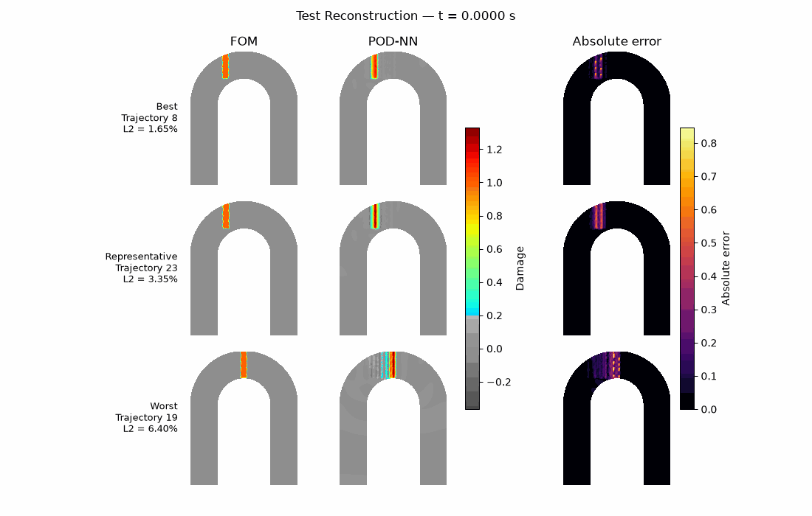

# Reduced Order Modeling for Transport and Damage Propagation

Academic computational modeling project exploring how reduced models can replace expensive finite-element simulations in repeated prediction, optimization, and parameter identification tasks.

Two applications are studied: chemical transport in a three-cylinder mixer and transient damage propagation in a U-bolt. The [problem statement](PROBLEM_STATEMENT.md) explains the physical questions, governing equations, and scope of each task in English.

See [Key results and code references](KEY_RESULTS.md) for the main numerical findings, their limitations, and where each analysis is implemented.

## Start here

| Application | Notebook | Main question |
| --- | --- | --- |
| Chemical mixing | [POD-Galerkin modeling and optimization](01-FEM-Surrogate-Modelling/Results.ipynb) | Can a POD-Galerkin model predict concentration fields and support optimization of cylinder velocities? |
| U-bolt forward prediction | [POD-NN surrogate](02-Dynamical_Systems-ROM/I%26II_Results.ipynb) | Can an L2-weighted POD basis and neural network approximate transient damage fields? |
| U-bolt inverse problem | [Parameter identification](02-Dynamical_Systems-ROM/III_Results.ipynb) | Which physical parameters explain the observed damage measurements? |
| U-bolt temporal extrapolation | [Reduced dynamics and forecasting](02-Dynamical_Systems-ROM/IV_Results.ipynb) | How reliably can reduced dynamics predict damage beyond the observed time interval? |

The notebooks include saved figures, mathematical explanations, and interpretation of results. The chemical mixing study is independent of the U-bolt study. For the U-bolt, read forward prediction, parameter identification, and temporal extrapolation in that order. Development notebooks and intermediate audits are excluded from the published file set.

## Methods and implementation

- Finite-element full-order models using legacy FEniCS and dlroms.
- POD-Galerkin reduction with Dirichlet lifting and affine offline/online decomposition.
- Mass-weighted POD, PyTorch neural surrogates, and parameter identification.
- DMD, continuous/discrete SINDy, Galerkin, hybrid, and POD-LSTM temporal models.
- Separate training, validation, and test assessments, with spatial error metrics and runtime comparisons.

Reusable code lives in `01-FEM-Surrogate-Modelling/MixerFunctions.py`, `01-FEM-Surrogate-Modelling/fenics_numpy_compat.py`, `02-Dynamical_Systems-ROM/support_functions.py`, and `02-Dynamical_Systems-ROM/extrapolation_functions.py`. Function docstrings describe inputs, outputs, array conventions, and relevant limitations in English. See the [support utilities guide](02-Dynamical_Systems-ROM/support_functions_guide.md) for the POD-NN workflow.

## Execution and required local files

Use a Linux/WSL environment with legacy FEniCS (`dolfin`), PETSc, dlroms, Gmsh, and `dolfin-convert`. Python dependencies used across the notebooks include NumPy, SciPy, PyTorch, pandas, Matplotlib, Jupyter/IPython, openpyxl, gdown, and PySINDy. The project contains compatibility checks for the legacy FEM stack; the existing setup notes identify NumPy 1.26.4 as the verified compatibility target. A complete portable environment specification is not yet included.

Run notebooks with their application directory as the working directory. Reading saved outputs does not require running the FEM or training pipeline.

| Stage | Required inputs |
| --- | --- |
| Chemical mixing | `MixerFunctions.py`, `fenics_numpy_compat.py`, and preferably the matching `mixer_mesh.xml`; the notebook loads or generates `FOMdata_assignment1.npz` |
| U-bolt forward prediction | `u-bolt.npz` and `support_functions.py`; training uses local checkpoint caches |
| U-bolt parameter identification | `artifacts/pod_basis.npy`, `artifacts/scaler.npz`, `artifacts/pod_nn_model.pt`, and sensor measurements (`damage_measurements.npy`, with download logic in the notebook) |
| U-bolt temporal extrapolation | The forward dataset, `artifacts/inverse_results.npz`, the POD basis, and the selected dynamics checkpoints referenced by the notebook |

Full-order datasets and trained model caches are excluded from Git. Only two selected forecast animations under `02-Dynamical_Systems-ROM/artifacts/` are included; numerical artifacts and checkpoints are excluded. A fresh clone supports reading the saved results but is insufficient to reproduce every notebook. Preserve the dataset mesh and DOF ordering when preparing inputs. Parameter identification and temporal extrapolation need the artifacts produced or exported by preceding stages; temporal extrapolation also references selected trained dynamics models.

## Scope and provenance

This repository develops coursework on model order reduction. The descriptions summarize the implemented problems in original wording; they do not reproduce the original assignment handout. Course-supplied geometry, data, and full-order routines should be attributed to their original providers before public distribution. The current repository does not establish redistribution rights for those materials.

Temporal extrapolation is evaluated as a modeling experiment. Numerical completion of a forecast is distinct from physical plausibility and agreement with a full-order reference. Historical helper definitions in `extrapolation_functions.py` are documented where later APIs supersede them; this remains a code-maintenance limitation.
